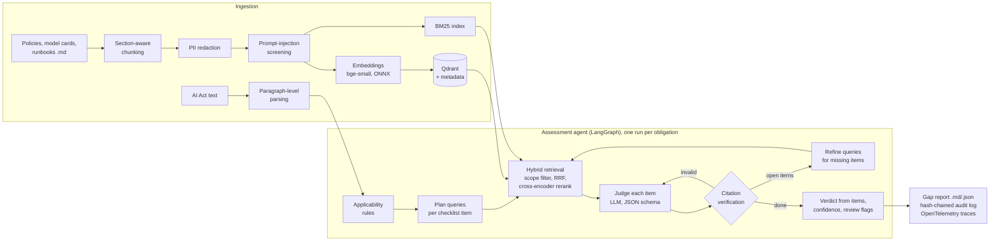

# ComplyRAG: EU AI Act gap analysis with agentic RAG

ComplyRAG checks a company's internal documentation against the obligations of
the EU AI Act for high-risk AI systems (Articles 9 to 15). It produces an
evidence-backed gap report. Every obligation gets a verdict (covered, partial,
gap or not applicable), a verbatim quote from the document that supports each
checklist item, a remediation note, and a flag when a person needs to review
the result.

This is the job a compliance consultant does by hand in the first weeks of an
AI Act readiness project. The demo case is **CreditLens**, a consumer credit
scoring model at a fictional German bank. Creditworthiness scoring is a
high-risk use case under Annex III, point 5(b).

```
$ complyrag assess
run-20261012-223628-02ba1c: covered=15 partial=6 gap=2 n/a=5 review=7
report: runs/run-20261012-223628-02ba1c.md
```

See [`docs/sample_report_offline.md`](docs/sample_report_offline.md) for a full report.

## Why this problem

* For stand-alone high-risk systems in Annex III, the obligations of Articles 9
  to 15 apply from **2 December 2027**. The date was moved from 2 August 2026 by
  the Digital Omnibus on AI, Regulation (EU) 2026/1744. Banks, insurers and HR
  tech providers are running readiness assessments now.
* Large banks are already building LLM tooling for this kind of work. Erste
  Group, for example, uses an AI governance agent that produces "reviewer-ready
  packets" on EU AI Act obligations with an auditable trail. Consultancies
  deliver regulatory document review with GraphRAG for clients in regulated
  industries.
* A plain RAG chatbot is not enough for this job, for three reasons:
  * **Evidence from the wrong system is the typical failure.** A bank has
    many AI systems, and their documents look alike. A strong human oversight
    procedure for the *fraud* model says nothing about the *credit* model.
    Naive retrieval cannot tell them apart.
  * **"Partial" is the most common answer, and it has to be precise.** The
    report must say which sub-requirement is missing, for example the stop
    procedure in Art. 14(4)(e).
  * **A false "covered" is the worst possible output.** It hides a gap that a
    regulator will later find. The system is designed around preventing it.

## What it does



| Stage | What happens | Why |
| --- | --- | --- |
| Parsing | Law is split into numbered paragraphs, policies into sections | A citation like "Art. 14(4)" maps to exactly one chunk; assessors cite sections |
| Obligation catalog | Each paragraph is broken into atomic checklist items ([yaml](data/obligations/ai_act_high_risk.yaml)) | Makes "partial" precise and lets the verdict be computed, not guessed |
| PII redaction | E-mails, phone numbers, IBANs and names are replaced before indexing | Personal data never reaches the vector store or the LLM |
| Injection screening | Chunks that address an AI ("ignore previous instructions...") are quarantined | Documents are an attack surface in RAG |
| Applicability | Decided by rules from the [system profile](data/obligations/system_profile_creditlens.yaml) | Whether a system is biometric is a fact, not a judgement call |
| Retrieval | BM25 + dense, merged per sub-query, cross-encoder reranking, filtered to the system in scope | Exact legal terms plus paraphrases; evidence from other systems is excluded |
| Judge | LLM decides each checklist item and quotes the evidence | Item-level output is checkable |
| Verification | Cited ids must have been retrieved, must belong to the system, and the quote must appear in the passage; failures go back to the judge | Stops invented or borrowed evidence |
| Refinement | Items still open trigger a second, targeted search | A gap is only reported after looking for it specifically |
| Finalize | Verdict = all items met / some / none; confidence and review flags | Same evidence, same verdict, every time |

## Results

All numbers below were produced by `python eval/run_eval.py` on the corpus in
this repo. The answer key is [`eval/gold/labels.yaml`](eval/gold/labels.yaml),
which covers 28 obligations, 23 of them applicable.

**Offline configuration**: LSA embeddings, no reranker, rule-based judge. This
set-up needs no model downloads and runs in CI.

Distractor study. The only difference between the three set-ups is how
evidence from the look-alike FraudGuard documents is handled:

| Set-up | Verdict accuracy | Macro-F1 | Gaps reported as "covered" |
| --- | --- | --- | --- |
| Naive RAG (no scope filter, no citation scope check) | 0.893 | 0.844 | **3** (A9.4, A10.2, A15.5) |
| Citation verifier only | 0.964 | 0.897 | 0 |
| Full pipeline (scope filter + verifier) | **1.000** | **1.000** | **0** |

Without the scope filter, about 8% of retrieved passages come from the wrong
system. In four obligations, a FraudGuard passage that would wrongly close a
gap reaches the evidence set. The citation verifier alone already prevents
every false "covered". The scope filter then removes the noise completely.

Retrieval ablation (recall@k / MRR, scope filter on): BM25 0.960 / 0.880,
dense LSA 0.872 / 0.686, hybrid 0.915 / 0.726. **With LSA as the dense
component, hybrid is worse than BM25 alone.** LSA is a weak semantic model, so
fusing it in adds noise. It also misses a paraphrase ("spot unusual behaviour"
vs. "detect anomalies") that a neural embedder should catch. The production
configuration uses `bge-small-en-v1.5` and a cross-encoder for exactly this
reason. Running `make eval-full` produces the same tables for that set-up.

Prompt-injection detector: precision 1.0 and recall 1.0 on 16 labelled
cases. The planted injection in the vendor questionnaire is quarantined at
ingestion.

**How to read these numbers.** The corpus and the answer key were written
for this project, and the rule-judge patterns were written by the same
person. The rule judge's accuracy therefore shows that the pipeline is wired
correctly. It does not show how well the system generalises. The informative
parts are the *differences* between set-ups (scope filter, verifier,
retrieval mode), and the LLM-judge run with neural retrieval (`make
eval-full`), whose results go in [`eval/results/`](eval/results/).

## Quick start

```bash
python -m venv .venv && source .venv/bin/activate
pip install -e ".[models,dev]"

# 1. Offline demo: no downloads, no LLM
make demo

# 2. Full pipeline with a local LLM
ollama pull qwen2.5:7b-instruct
cp .env.example .env
complyrag index
complyrag assess
complyrag search "who can stop the model"   # inspect retrieval

# 3. API
complyrag serve
curl -X POST localhost:8000/assessments -H 'content-type: application/json' \
     -d '{"obligation_ids": ["A14.4", "A15.5"]}'

# 4. Everything in containers (API + Ollama + Jaeger)
docker compose up --build -d
```

The LLM endpoint can be anything that speaks the OpenAI chat API: Ollama or
vLLM on premises, Azure OpenAI in an EU data zone, or OpenAI. See
[`.env.example`](.env.example).

## Project layout

```
complyrag/
  ingestion/        regulation parser (paragraph-level), section-aware document chunker
  security/         PII redaction, prompt-injection screening
  retrieval/        ONNX embeddings, BM25, Qdrant store, RRF, reranker, hybrid retriever
  agents/           LangGraph workflow, query planner, judges, citation verification
  llm/              OpenAI-compatible client (JSON repair, retries, cache, cost), prompts
  observability/    OpenTelemetry tracing, hash-chained audit log
  index.py          ingestion pipeline and index versioning
  pipeline.py       end-to-end assessment run
  api.py, cli.py    FastAPI service and Typer CLI
data/
  regulation/       AI Act text (Apache-2.0 dataset, unmodified)
  obligations/      obligation catalog with checklists, system profile
  company/          fictional bank documentation with planted gaps
  distractors/      look-alike documents from another system, GDPR notice, injection
eval/               answer key, harness, results
docs/               architecture decision records, sample report
tests/              37 tests, all offline
```

## Design decisions

The reasoning behind each choice, and the alternatives that were considered,
is written down as architecture decision records:

1. [Gap analysis instead of a Q&A chatbot](docs/adr/0001-gap-analysis-not-chatbot.md)
2. [Structure-aware chunking and checklist decomposition](docs/adr/0002-chunking-and-checklists.md)
3. [Hybrid retrieval, scope filtering and reranking](docs/adr/0003-hybrid-retrieval.md)
4. [Agent workflow: the LLM judges items, code decides verdicts](docs/adr/0004-agent-workflow.md)
5. [Guardrails: PII, prompt injection, citation verification](docs/adr/0005-guardrails.md)
6. [Model access through one OpenAI-compatible interface](docs/adr/0006-model-access.md)
7. [Evaluation strategy and CI gate](docs/adr/0007-evaluation.md)
8. [Observability, audit and versioning](docs/adr/0008-observability-governance.md)

## Limitations and next steps

* Only Articles 9 to 15 (provider obligations) are covered. Deployer
  obligations (Art. 26), the quality management system (Art. 17) and Annex IV
  in detail are natural extensions of the catalog.
* The regulation text is the 2024 original. Amendments by Regulation (EU)
  2026/1744 must be checked against the obligation catalog before real use.
* Documents are Markdown. PDF and Word ingestion with layout-aware parsing,
  such as Docling or Azure Document Intelligence, is the next ingestion step.
* PII detection uses regular expressions. A production deployment should add
  an NER-based detector such as Presidio.
* Assessments run synchronously. For portfolios of many systems, a job queue
  and a review UI where people confirm or correct findings are the next steps.
  Those corrections become new evaluation data.

This project produces a working document for compliance experts. It is not
legal advice.

## Sources

* Regulation (EU) 2024/1689 (AI Act): https://eur-lex.europa.eu/eli/reg/2024/1689/oj
* AI Act text used here: https://huggingface.co/datasets/laredoyin/eu-ai-act (Apache-2.0)
* Digital Omnibus on AI entering into force, new Annex III date: https://www.mondaq.com/eu-digital-omnibus-on-ai-enters-into-force/1825722
* Erste Group AI governance agent (Databricks): https://www.databricks.com/blog/adaptive-data-governance-eu-regulatory-change
* GraphRAG for regulatory document review at an FMCG (Eraneos): https://www.eraneos.com/impact-stories/using-ai-to-streamline-the-document-review-process-and-address-regulatory-challenges-at-an-fmcg/
* Accenture regulatory document authoring on AWS: https://aws.amazon.com/blogs/machine-learning/accenture-creates-a-regulatory-document-authoring-solution-using-aws-generative-ai-services/
* Cormack, Clarke, Buettcher (2009), Reciprocal Rank Fusion
